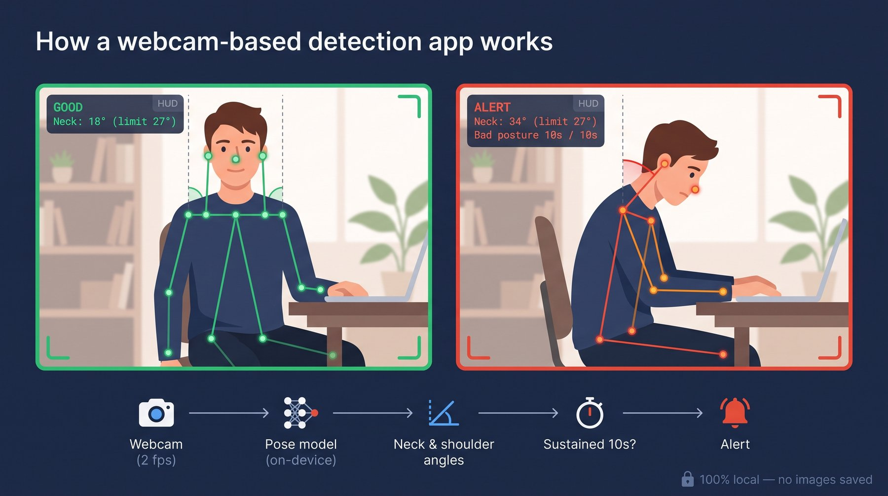

<h1 align="center">Escapula</h1>

<p align="center">
  <strong>Webcam-based posture monitor for Windows</strong><br>
  Watches your posture through the webcam and alerts you when you slouch for too long.
</p>

<p align="center">
  
</p>

<p align="center">
  
  
  
  
</p>

---

## Features

- **Two detection modes** — `ai` (MediaPipe pose model, real neck/shoulder angles) or `heuristic` (OpenCV face detection, no model).
- **Personal calibration** — learns *your* good posture instead of using generic thresholds.
- **No false alarms** — bad posture must be sustained (~10 s) before alerting; brief movements are ignored.
- **Configurable alerts** — tray icon color, Windows notification and repeating beep, each one on/off.
- **Private by design** — frames live only in memory; the model runs offline on your CPU.

## How it works

Each webcam frame (2 fps) goes through [MediaPipe's Pose Landmarker](https://ai.google.dev/edge/mediapipe/solutions/vision/pose_landmarker), an on-device model that tracks 33 body landmarks. Escapula only uses the **ears, nose, shoulders and hips**: from them it computes the **neck angle** (ear vs. shoulder) and a **shoulder slouch score**, and compares them with your calibrated limits.

<p align="center">
  <br>
  <sub>The 33 landmarks MediaPipe tracks per frame (image: Google MediaPipe).</sub>
</p>

A sliding-window vote filters per-frame noise, and a `GOOD → SUSPECT → ALERTED` state machine only alerts once bad posture has lasted long enough, clearing again after a few seconds of good posture.

<sub>The image at the top is an illustration — the real live view can be enabled with `debug_preview_enabled` in `config.jsonc`.</sub>

## Installation

Requires **Windows 10/11**, a webcam and **Python 3.11** (MediaPipe doesn't support 3.13 yet — check with `py -0`).

```powershell
git clone https://github.com/jjvelezo/escapula.git
cd escapula
py -3.11 -m venv .venv
.venv\Scripts\activate
pip install -r requirements.txt
```

## Usage

```powershell
.venv\Scripts\activate
python escapula.py
```

**First run**

1. The AI model (~6 MB) downloads once into `models/`.
2. A calibration window opens: sit up straight and press **SPACE**, then slouch as you usually do and press **SPACE** again (or **S** to skip).
3. Escapula keeps running in the background with an icon in the system tray.

**Tray icon**

| Color | Meaning |
|---|---|
| 🟢 Green | Good posture |
| 🟡 Amber | Bad posture, not yet sustained |
| 🔴 Red (blinking) | Alert — sit up straight |
| ⚪ Gray | No reading (nobody in frame) |
| 🔵 Blue | Paused |

Right-click it to **Pause**, **Recalibrate** or **Quit**.

## Configuration

All options live in `config.jsonc` at the project root, created on the first run. Every option has a comment explaining it; the most common ones are at the top. Close Escapula, edit the file, and start it again.

| Option | Default | Description |
|---|---|---|
| `mode` | `"ai"` | `"ai"` or `"heuristic"`. Recalibrate after changing. |
| `camera_index` | `0` | Webcam to use (`0`, `1`, `2`…). |
| `debug_preview_enabled` | `false` | Live window showing the detection (skeleton, angles, state). |
| `tray_enabled` | `true` | Colored tray icon. |
| `toast_enabled` | `true` | Windows notification. |
| `toast_sound_enabled` | `true` | Sound on the notification. |
| `toast_cooldown_seconds` | `300` | Minimum time between notifications. |
| `sound_alert_enabled` | `true` | Repeating beep while alerted. |
| `sound_alert_interval_seconds` | `8` | Time between beeps. |
| `bad_posture_hold_seconds` | `10` | How long bad posture must last before alerting. |
| `good_posture_release_seconds` | `5` | How long good posture must last to clear the alert. |

To get **color only, no sound**, set `toast_sound_enabled` and `sound_alert_enabled` to `false`.
To redo calibration, use **Recalibrate** in the tray menu.

## Privacy

Webcam frames are never written to disk or transmitted. Only derived numbers (angles, positions) leave the detection code, and all inference runs locally — there are no cloud calls.

## Project structure

```
escapula.py                 Entry point
posture_guard/
├── app.py                  Wires the pipeline together
├── capture.py              Webcam loop
├── calibration.py          Calibration wizard
├── posture_state.py        Smoothing + state machine
├── config.py               Settings (config.jsonc)
├── debug_view.py           Live debug preview
├── detectors/              ai_detector.py · heuristic_detector.py
└── alerts/                 tray.py · toast.py · sound.py
```
